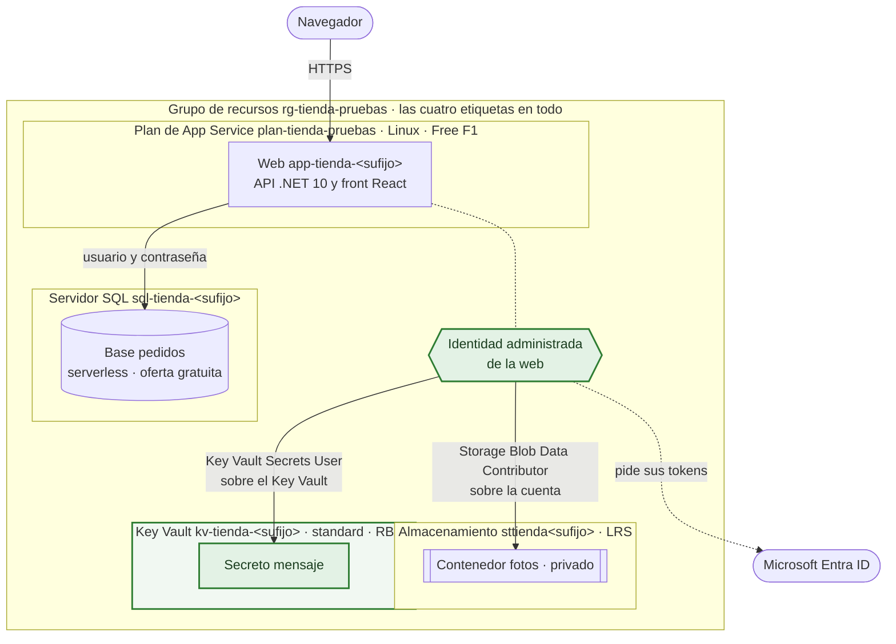
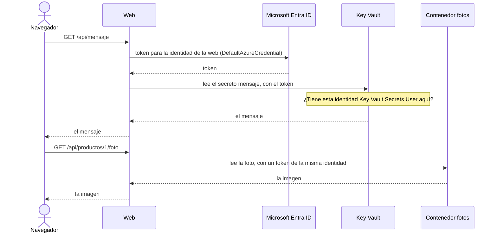
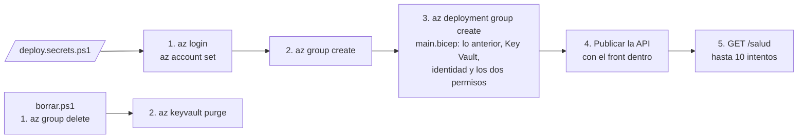

# Arquitectura en Azure · Módulo 4

**Rama:** `modulo-4/identidad-y-secretos` · Lo que hay en Azure después de lanzar `desplegar.ps1` en esta rama. Cada rama trae su propia versión de este fichero, y dibuja solo lo que se monta en ella.

La web recibe una identidad administrada y, con ella, entra al almacenamiento y al Key Vault sin ninguna clave. Cada permiso va sobre un solo recurso. La base sigue con usuario y contraseña: darle acceso a la identidad necesita una orden dentro de la propia base, y eso el Bicep no lo puede declarar.

## Lo que hay en Azure

En verde, lo que añade este módulo.

| Recurso | Nombre | Nivel | Lo que cuesta |
|---|---|---|---|
| Identidad administrada | La de `app-tienda-<sufijo>` | Asignada por el sistema: nace y muere con la web | Nada |
| Key Vault | `kv-tienda-<sufijo>` | Standard, permisos por RBAC, borrado temporal de 7 días | Céntimos: se paga por operación, y la web lee un solo secreto |
| Secreto | `mensaje` | Un texto inofensivo que la web enseña | Va en el Key Vault |
| Permiso | Storage Blob Data Contributor | Sobre la cuenta de almacenamiento, no sobre el grupo | Nada |
| Permiso | Key Vault Secrets User | Sobre el Key Vault, no sobre el grupo | Nada |

El resto sigue como en el módulo 3: el plan y la web, el servidor SQL con su base gratuita (en la región de `$UbicacionSql` si la pones) y el almacenamiento con su contenedor y su ciclo de vida.

## Cómo entra la web sin claves

En ningún momento viaja una contraseña. La web demuestra quién es ante Entra ID, y cada recurso mira si esa identidad tiene el rol que hace falta. Si alguien quita el permiso, el recurso responde con un 403 y la fila correspondiente de `/salud` sale en rojo.

## Las credenciales

| Ajuste de la web | Qué lleva |
|---|---|
| `ConnectionStrings__Pedidos` | El servidor, la base, el usuario `tiendaadmin` y su contraseña: el único secreto que queda |
| `Tienda__BlobUri` | La dirección del almacenamiento, que sola no abre nada |
| `Tienda__KeyVaultUri` | La dirección del Key Vault, que tampoco |
| `Tienda__Contenedor` | `fotos` |

`ConnectionStrings__Fotos`, la cadena con la clave de la cuenta, ya no existe.

## La red

| Pieza | Acceso público | Quién entra |
|---|---|---|
| Web | Sí, por HTTPS | Cualquiera con la dirección |
| Servidor SQL | Sí, cerrado por el cortafuegos | Los servicios de Azure, con usuario y contraseña |
| Almacenamiento | Sí, sin acceso anónimo | Una identidad con rol de datos sobre la cuenta, como la de la web. La clave de la cuenta sigue existiendo, aunque la web ya no la usa |
| Key Vault | Sí | Una identidad con rol sobre el Key Vault, como la de la web |

Todavía no hay red virtual: la identidad decide quién entra, no la red. Meter los tres recursos detrás de endpoints privados es lo que añadiría la versión de producción.

## Cómo se monta y cómo se borra

Los permisos de una identidad recién creada pueden tardar unos minutos en aplicarse: por eso el paso 5 reintenta. Y `borrar.ps1` purga el Key Vault después de borrar el grupo. Sin ese paso, el Key Vault se quedaría siete días en la papelera con su nombre reservado, y el siguiente despliegue chocaría con él.

## Lo que llega después

El módulo 5 pone un presupuesto sobre el grupo, con avisos al responsable cuando el gasto previsto del mes se acerca al importe.
