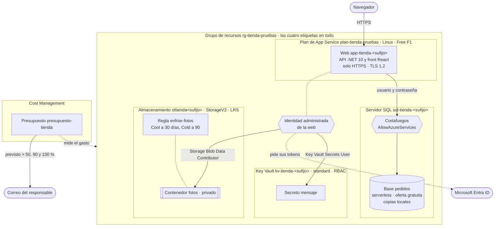
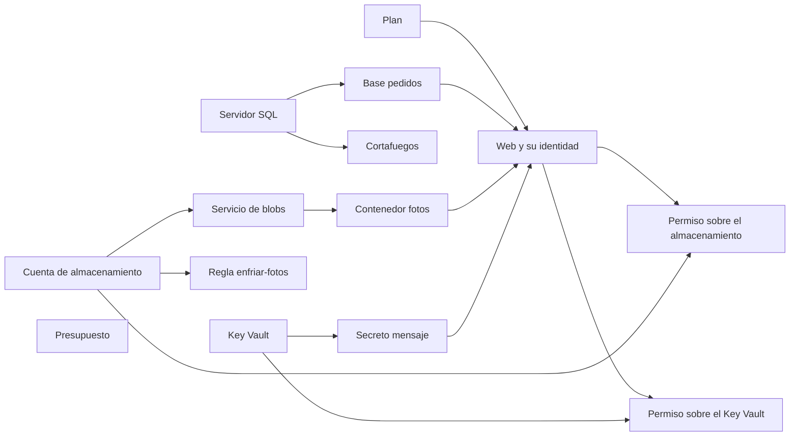
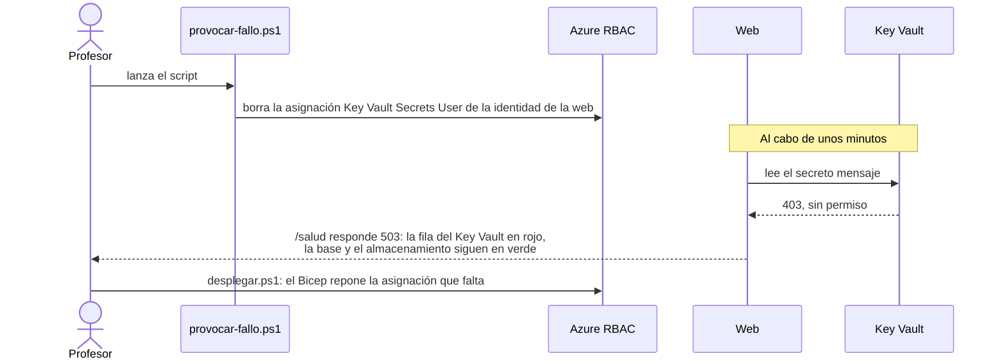
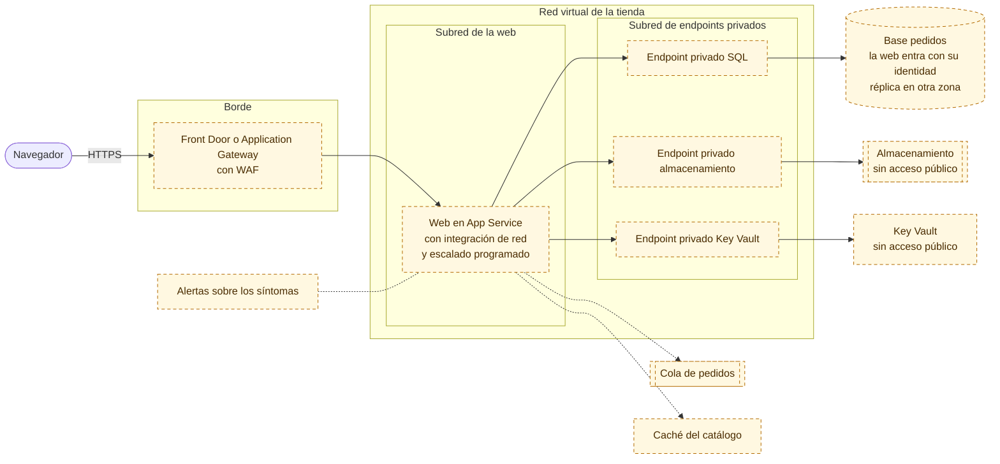
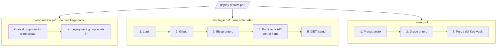

# Arquitectura en Azure · Módulo 6

**Rama:** `modulo-6/un-comando` (igual que `main`) · Lo que hay en Azure después de lanzar `desplegar.ps1` en esta rama. Cada rama trae su propia versión de este fichero, y dibuja solo lo que se monta en ella.

Es la tienda entera, y se monta desde un grupo vacío con una sola orden. El módulo 6 no añade recursos. Añade tres cosas para mirar la arquitectura desde fuera: el orden en que Bicep crea las piezas, un fallo provocado para ver qué se rompe y qué no, y la distancia hasta una versión de producción.

## Lo que hay en Azure

| Recurso | Nombre | Nivel | Módulo |
|---|---|---|---|
| Grupo de recursos | `rg-tienda-pruebas` | Las cuatro etiquetas | 1 |
| Plan de App Service | `plan-tienda-pruebas` | Linux, Free (F1) | 2 |
| Web | `app-tienda-<sufijo>` | .NET 10, solo HTTPS, TLS 1.2 | 2 |
| Servidor SQL y cortafuegos | `sql-tienda-<sufijo>`, `AllowAzureServices` | TLS 1.2; solo los servicios de Azure | 3 |
| Base de datos | `pedidos` | General Purpose serverless, 2 vCores, oferta gratuita, copias locales | 3 |
| Cuenta de almacenamiento | `sttienda<sufijo>` | StorageV2, Standard LRS, Hot, sin acceso anónimo | 3 |
| Contenedor y ciclo de vida | `fotos`, `enfriar-fotos` | Privado; Cool a 30 días, Cold a 90 | 3 |
| Identidad administrada | La de la web | Asignada por el sistema | 4 |
| Key Vault y secreto | `kv-tienda-<sufijo>`, `mensaje` | Standard, RBAC, borrado temporal de 7 días | 4 |
| Permisos | Storage Blob Data Contributor, Key Vault Secrets User | Cada uno sobre un solo recurso | 4 |
| Presupuesto | `presupuesto-tienda` | Mensual, avisos al 50, 90 y 100 % del previsto | 5 |

Todo va en la región de `$Ubicacion`, menos el servidor SQL y su base, que van en la de `$UbicacionSql` si la pones: la oferta gratuita pone todas las bases gratuitas de una suscripción en la misma región.

## En qué orden lo crea Bicep

Nadie escribe el orden: Bicep lo calcula a partir de lo que cada recurso necesita. Una flecha de A a B quiere decir que B no empieza hasta que A existe. Lo que no tiene flechas entre sí se crea a la vez.

La web es la pieza que más espera: su configuración lleva la dirección de la base, la del almacenamiento y la del Key Vault. Y los permisos esperan a la web, porque se dan a su identidad, que nace con ella. El presupuesto no depende de nada y se crea a la vez que el resto.

## El fallo provocado

Lo interesante no es que falle el Key Vault, sino que **solo** falle el Key Vault. Cada pieza tiene su propia comprobación en `/salud`, así que el panel señala la pieza rota y deja en verde el resto.

## La red

| Pieza | Acceso público | Quién entra |
|---|---|---|
| Web | Sí, por HTTPS | Cualquiera con la dirección |
| Servidor SQL | Sí, cerrado por el cortafuegos | Los servicios de Azure, con usuario y contraseña |
| Almacenamiento | Sí, sin acceso anónimo | Una identidad con rol de datos, como la de la web |
| Key Vault | Sí | Una identidad con rol, como la de la web |

No hay red virtual, ni endpoints privados, ni borde con cortafuegos de aplicaciones web. Es una decisión, no un olvido: la tienda se monta y se borra en una clase, y la identidad ya decide quién entra a cada recurso. La lista de comprobación lo anota como pendiente para producción.

## La versión de producción (no se despliega)

Este diagrama no lo monta ningún script. Es la distancia entre la tienda del curso y una de verdad, sacada de `docs/lista-comprobacion.md`. El diseño de la red, con sus subredes, zonas DNS, reglas y lo que cuesta, está en `docs/red-virtual.md`.

| Lo que falta para producción | Dónde se decidió |
|---|---|
| Réplica de la base y copias en otra zona | Módulo 3 |
| Escalado programado y la cola de pedidos | Módulo 2 |
| La base sin contraseña, y la red privada | Módulo 4 |
| El borde con cortafuegos de aplicaciones web | Módulo 4 |
| Alertas sobre los síntomas | Módulo 5 |
| Caché para el catálogo y las sesiones | Módulo 3 |

## Cómo se monta y cómo se borra

Con estas dos órdenes, montar y borrar, la tienda deja de ser algo que se monta a mano y pasa a ser algo que se repite. Y eso es lo que permite probarla en clase, romperla a propósito y volver a dejarla como estaba.
