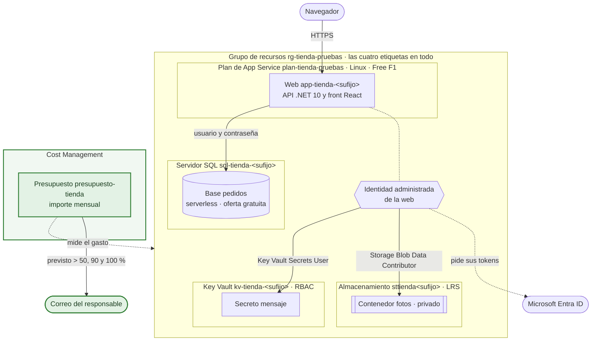
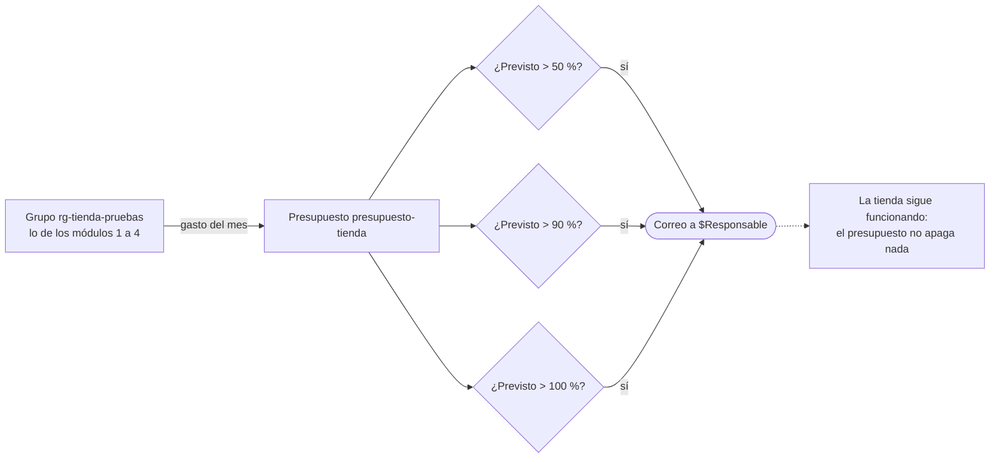
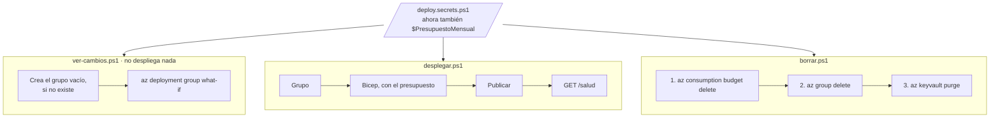

# Arquitectura en Azure · Módulo 5

**Rama:** `modulo-5/costes` · Lo que hay en Azure después de lanzar `desplegar.ps1` en esta rama. Cada rama trae su propia versión de este fichero, y dibuja solo lo que se monta en ella.

La tienda no cambia; lo que cambia es que alguien se entera de lo que cuesta. Un presupuesto de Cost Management vigila el gasto del grupo y avisa al responsable antes de que se pase. Avisa y no corta nada: si el gasto se pasa, la tienda sigue funcionando.

## Lo que hay en Azure

En verde, lo que añade este módulo.

| Recurso | Nombre | Cómo está | Lo que cuesta |
|---|---|---|---|
| Presupuesto de Cost Management | `presupuesto-tienda` | Sobre el grupo, mensual, desde el día 1 del mes en curso, por el importe de `$PresupuestoMensual` | Nada |
| Aviso | `previsto-50` | Cuando el gasto **previsto** del mes pasa del 50 % | Nada |
| Aviso | `previsto-90` | Del 90 % | Nada |
| Aviso | `previsto-100` | Del 100 % | Nada |

Los tres avisos van al correo de `$Responsable`, el mismo de la etiqueta `responsable`. Se miden sobre el gasto previsto y no sobre el real porque así llegan antes: el previsto calcula hasta dónde llegará el mes al ritmo que lleva, y avisa cuando aún hay margen para reaccionar.

El resto sigue como en el módulo 4: la web con su identidad y sus dos permisos, la base gratuita (en la región de `$UbicacionSql` si la pones), el almacenamiento y el Key Vault.

## Cómo llega un aviso

## La red

Igual que en el módulo 4. El presupuesto no tiene dirección: vive en Cost Management, fuera del grupo, y por eso `borrar.ps1` lo borra aparte.

| Pieza | Acceso público | Quién entra |
|---|---|---|
| Web | Sí, por HTTPS | Cualquiera con la dirección |
| Servidor SQL | Sí, cerrado por el cortafuegos | Los servicios de Azure, con usuario y contraseña |
| Almacenamiento | Sí, sin acceso anónimo | Una identidad con rol de datos, como la de la web |
| Key Vault | Sí | Una identidad con rol, como la de la web |

## Cómo se ve, se monta y se borra

`ver-cambios.ps1` es el plan antes de aplicar. Lanza el what-if de Bicep con los mismos valores que `desplegar.ps1` y enseña, recurso a recurso, qué se crearía, qué se modificaría y qué quedaría igual.

## Lo que llega después

El módulo 6 no añade recursos. Monta la tienda entera desde un grupo vacío con una sola orden, la pasa por la lista de comprobación y provoca un fallo para verlo en el panel de estado.
