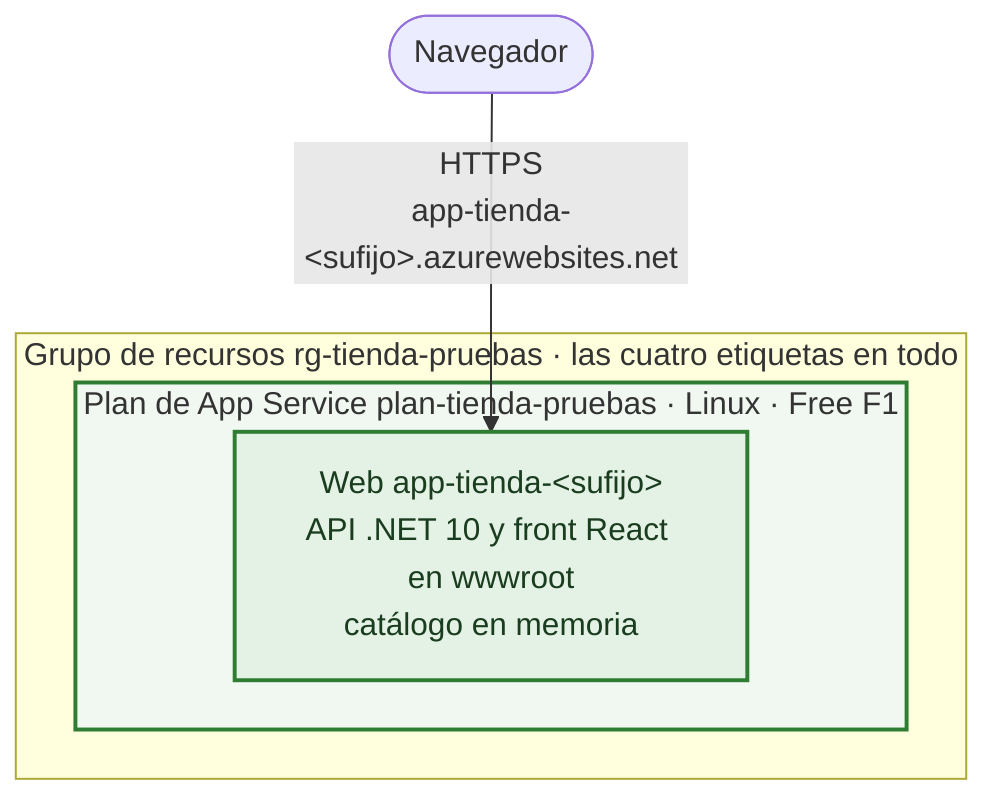
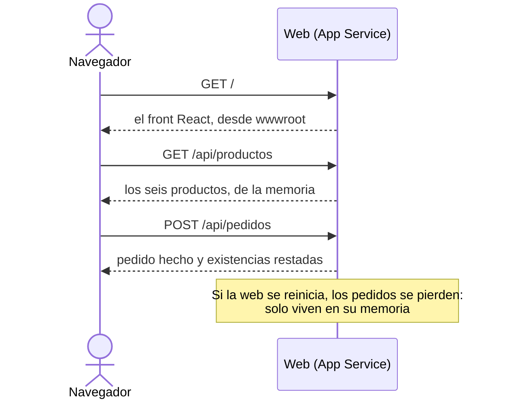
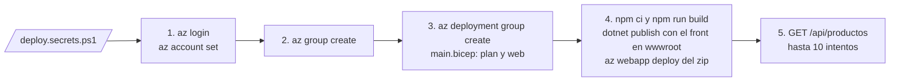

# Arquitectura en Azure · Módulo 2

**Rama:** `modulo-2/app-service` · Lo que hay en Azure después de lanzar `desplegar.ps1` en esta rama. Cada rama trae su propia versión de este fichero, y dibuja solo lo que se monta en ella.

La tienda ya funciona en Azure. Una sola web sirve la API .NET y el front React, porque el front es un puñado de ficheros estáticos que la propia API puede servir. Los datos, de momento, viven en su memoria.

## Lo que hay en Azure

En verde, lo que añade este módulo.

| Recurso | Nombre | Nivel | Lo que cuesta |
|---|---|---|---|
| Plan de App Service | `plan-tienda-pruebas` | Linux, Free (F1) | Nada. A cambio, 60 minutos de CPU al día, sin Always On y sin deployment slots |
| Web | `app-tienda-<sufijo>` | .NET 10, solo HTTPS, TLS 1.2 como mínimo | Va dentro del plan |

El `<sufijo>` lo calcula el Bicep a partir del identificador del grupo. Para el mismo grupo sale siempre igual, así que la dirección no cambia al relanzar.

La web arranca desde el paquete que sube el script (`WEBSITE_RUN_FROM_PACKAGE=1`): lo que corre en Azure es exactamente ese zip, y nadie toca ficheros sueltos en el servidor.

## Cómo responde la tienda

## La red

| Pieza | Acceso público | Quién entra |
|---|---|---|
| Web | Sí, por HTTPS; lo que llega por HTTP se redirige | Cualquiera con la dirección |

No hay red virtual ni borde con cortafuegos delante. La web recibe las peticiones directamente en su dirección de `azurewebsites.net`, que es lo que da App Service sin configurar nada más.

## Cómo se monta

`borrar.ps1` borra el grupo entero, con el plan y la web dentro.

## Lo que llega después

El módulo 3 saca los datos de la memoria: el catálogo y los pedidos van a Azure SQL Database, y las fotos a Blob Storage.
