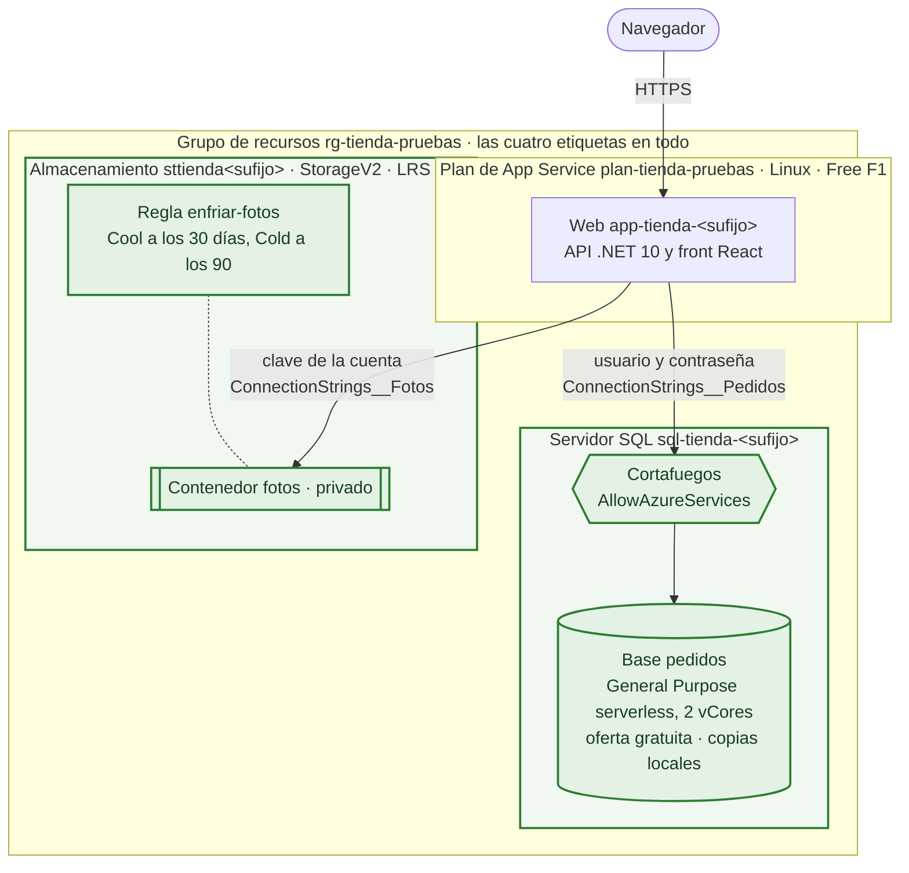
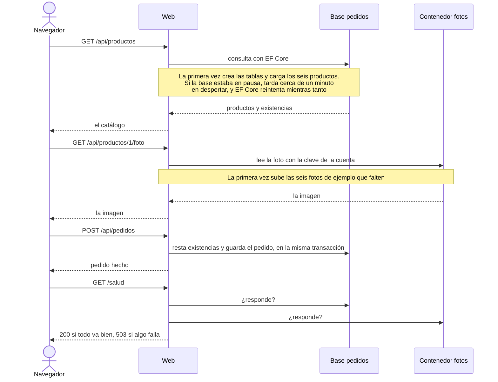
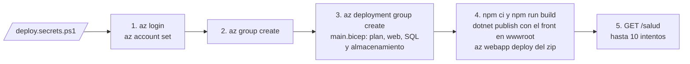

# Arquitectura en Azure · Módulo 3

**Rama:** `modulo-3/datos` · Lo que hay en Azure después de lanzar `desplegar.ps1` en esta rama. Cada rama trae su propia versión de este fichero, y dibuja solo lo que se monta en ella.

Los datos salen de la memoria de la web. Los pedidos van a una base relacional, porque tienen que cuadrar, y las fotos a un almacenamiento de objetos con su ciclo de vida. La web entra a los dos con credenciales escritas en su configuración, que es justo lo que arregla el módulo 4.

## Lo que hay en Azure

En verde, lo que añade este módulo.

| Recurso | Nombre | Nivel | Lo que cuesta |
|---|---|---|---|
| Servidor SQL | `sql-tienda-<sufijo>` | Administrador `tiendaadmin`, TLS 1.2 como mínimo | Nada por sí solo |
| Regla del cortafuegos | `AllowAzureServices` | `0.0.0.0`: deja entrar a los servicios de Azure | Nada |
| Base de datos | `pedidos` | General Purpose serverless, Gen5, 2 vCores. Oferta gratuita que se pausa al agotar el cupo, con copias de seguridad locales | Nada: cada mes trae 100.000 segundos de vCore y 32 GB |
| Cuenta de almacenamiento | `sttienda<sufijo>` | StorageV2, Standard LRS, nivel Hot, sin acceso anónimo | Céntimos: seis fotos y pocas operaciones |
| Contenedor | `fotos` | Privado | Va en la cuenta |
| Regla de ciclo de vida | `enfriar-fotos` | Cool a los 30 días sin cambios, Cold a los 90 | Nada |

Todo va en la región del grupo menos el servidor SQL y su base, que van en la de `$UbicacionSql` si la pones en `deploy.secrets.ps1`. La oferta gratuita pone todas las bases gratuitas de una suscripción en la misma región: si ya tienes alguna en otra, la tienda la sigue.

## Cómo responde la tienda

## Las credenciales

| Ajuste de la web | Qué lleva |
|---|---|
| `ConnectionStrings__Pedidos` | El servidor, la base, el usuario `tiendaadmin` y su contraseña |
| `ConnectionStrings__Fotos` | El nombre de la cuenta y su clave, que abre la cuenta entera |
| `Tienda__Contenedor` | `fotos` |

Las dos cadenas las escribe el Bicep al desplegar: nadie copia una dirección ni una clave a mano. Aun así, la contraseña y la clave quedan a la vista de cualquiera que pueda leer la configuración de la web.

## La red

| Pieza | Acceso público | Quién entra |
|---|---|---|
| Web | Sí, por HTTPS | Cualquiera con la dirección |
| Servidor SQL | Sí, cerrado por el cortafuegos | Los servicios de Azure, con usuario y contraseña |
| Almacenamiento | Sí, sin acceso anónimo | Quien tenga la clave de la cuenta |

Ojo con lo que deja pasar `AllowAzureServices`: cualquier servicio de Azure, no solo esta web. Para una clase vale. En producción la base iría sin acceso público, detrás de un endpoint privado en una red virtual.

## Cómo se monta

Dentro del paso 3, la web espera a que existan la base y el contenedor: su configuración lleva las dos cadenas, y no se pueden escribir antes. `borrar.ps1` borra el grupo entero, con todo dentro.

## Lo que llega después

El módulo 4 da a la web una identidad propia. Con ella, la clave del almacenamiento desaparece de la configuración, y llega un Key Vault.
