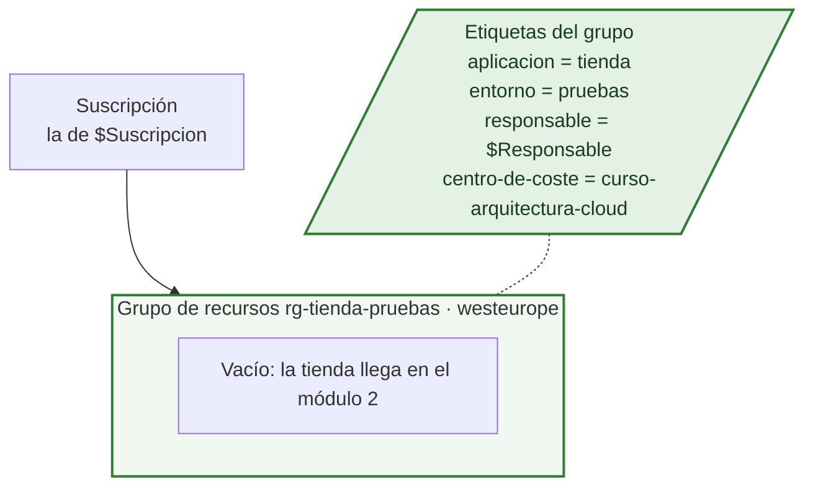
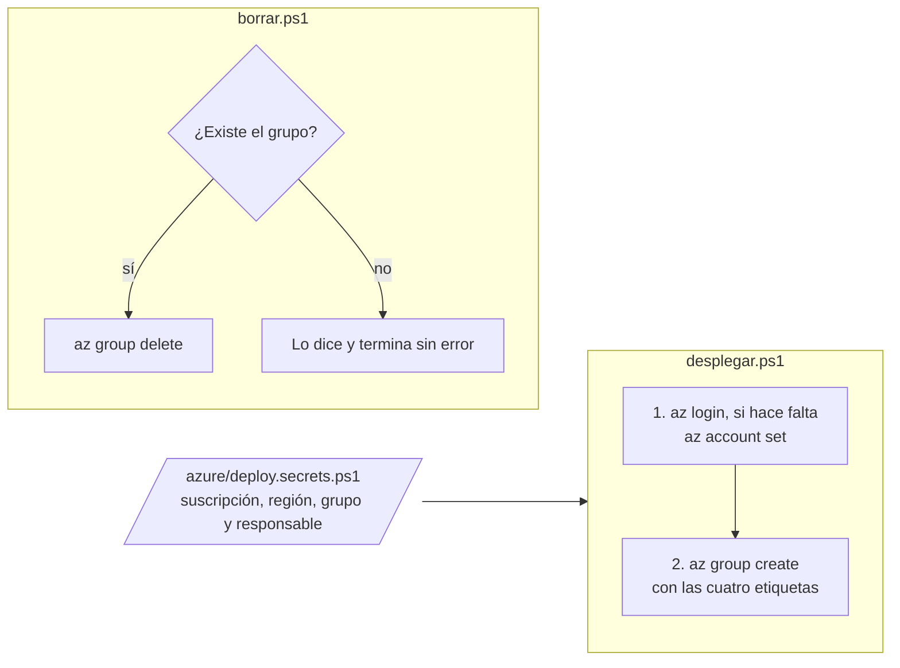

# Arquitectura en Azure · Módulo 1

**Rama:** `modulo-1/grupo-de-recursos` · Lo que hay en Azure después de lanzar `desplegar.ps1` en esta rama. Cada rama trae su propia versión de este fichero, y dibuja solo lo que se monta en ella.

En el módulo 1 todavía no hay tienda: solo el sitio donde va a vivir. Parece poca cosa, pero aquí se decide lo que más cuesta cambiar después. En qué suscripción entra, cómo se llama su grupo y en qué región va.

## Lo que hay en Azure

En verde, lo que añade este módulo.

| Recurso | Nombre | Región | Lo que cuesta |
|---|---|---|---|
| Grupo de recursos | `rg-tienda-pruebas` (el de `$GrupoRecursos`) | `westeurope` (la de `$Ubicacion`) | Nada |

Los valores salen de `azure/deploy.secrets.ps1`; los de la tabla son los de la plantilla. La región del grupo es donde Azure guarda los datos que lo describen, no una obligación para lo que se meta dentro, aunque la tienda pondrá ahí casi todo.

## La red

No hay nada que exponer. Un grupo vacío no tiene direcciones, ni puertos, ni nada a lo que llamar.

## Cómo se monta y cómo se borra

`desplegar.ps1` se puede lanzar las veces que haga falta: si el grupo ya existe, lo deja como está y actualiza sus etiquetas.

## Lo que llega después

El módulo 2 mete en este grupo un plan de App Service y la web con la tienda.
