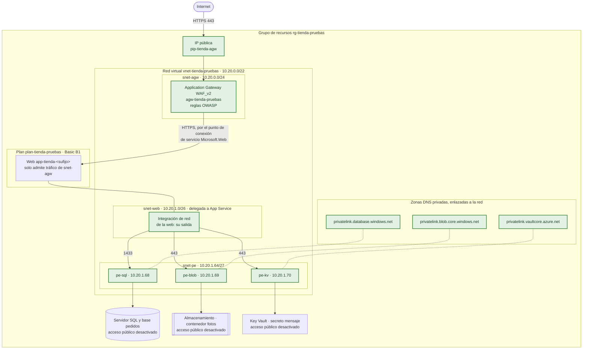
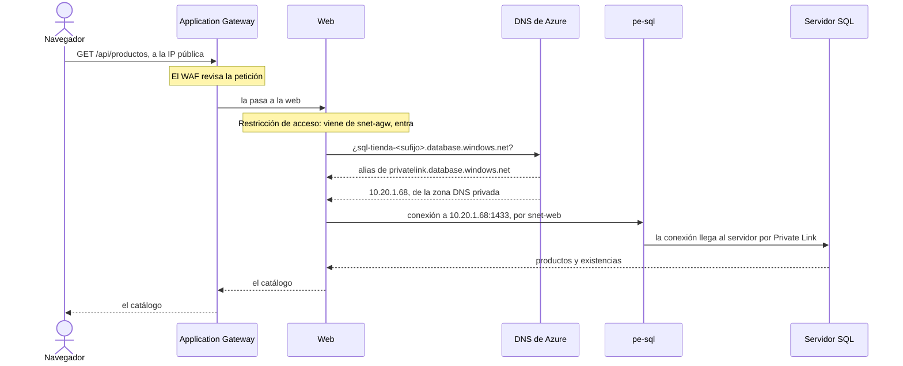
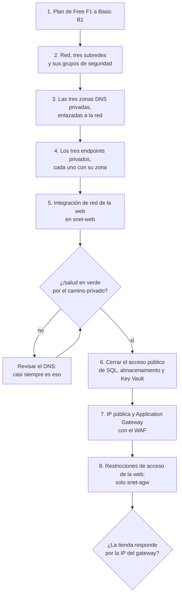

# La red virtual de la tienda (diseño, sin desplegar)

> **Esto no lo monta ningún script.** Es el diseño de cómo quedaría la red de la tienda en una versión de producción: qué redes y subredes crearíamos, qué servicios entrarían en ellas, qué se cierra a Internet y lo que cuesta. El `main.bicep` de este repositorio no cambia.

Hoy la tienda no tiene red virtual. Cada pieza tiene su dirección pública y la que decide quién entra es la identidad, salvo en la base, que todavía usa contraseña. Funciona, y para una clase basta. En producción, la idea cambia de raíz: **solo el borde mira a Internet**, y todo lo demás habla por direcciones privadas.

## Cómo quedaría

En verde, lo que no existe hoy. El resto son los recursos de siempre, con dos cambios: el plan sube de Free a Basic, porque la integración de red no existe en el nivel gratuito, y la base, el almacenamiento y el Key Vault cierran su acceso público.

## Las redes que crearíamos

Una sola red virtual, en la región del grupo, con tres subredes y sitio de sobra para crecer.

| Red o subred | Rango | Direcciones | Para qué |
|---|---|---|---|
| `vnet-tienda-pruebas` | `10.20.0.0/22` | 1.024 | La red de la tienda |
| `snet-agw` | `10.20.0.0/24` | 256 | El Application Gateway. Tiene que ser una subred solo para él, y Microsoft recomienda un /24 para que pueda escalar |
| `snet-web` | `10.20.1.0/26` | 64 | La integración de red de la web: por aquí **sale** lo que la web pide. Delegada a `Microsoft.Web/serverFarms`; /26 es el tamaño que recomienda Microsoft |
| `snet-pe` | `10.20.1.64/27` | 32 | Los endpoints privados: una IP privada por cada servicio |
| Libre | `10.20.1.96` a `10.20.3.255` | 672 | Reserva para la cola, la caché o una subred de administración |

¿Por qué `10.20.x` y no `10.0.x`? Porque `10.0.0.0/16` es lo primero que propone todo el mundo. Si algún día hay que conectar esta red con la de la oficina o con otra suscripción, dos redes con el mismo rango no se pueden emparejar. Elegir un rango menos obvio desde el principio no cuesta nada.

Azure se reserva cinco direcciones de cada subred, así que en `snet-pe` quedan 27 para endpoints. Sobran: la tienda usa tres.

## Los servicios que entrarían en la red

| Servicio | Nombre | Dónde | Qué hace |
|---|---|---|---|
| IP pública | `pip-tienda-agw` | Fuera de la red | La única dirección pública de la tienda |
| Application Gateway WAF_v2 | `agw-tienda-pruebas` | `snet-agw` | El borde: termina el HTTPS, filtra con las reglas OWASP del WAF y pasa la petición a la web |
| Integración de red de la web | La de `app-tienda-<sufijo>` | `snet-web` | Mete en la red el tráfico que sale de la web |
| Endpoint privado de SQL | `pe-sql` | `snet-pe` | El servidor SQL con una IP privada |
| Endpoint privado de blobs | `pe-blob` | `snet-pe` | El almacenamiento de las fotos con una IP privada |
| Endpoint privado del Key Vault | `pe-kv` | `snet-pe` | El Key Vault con una IP privada |
| Zona DNS privada | `privatelink.database.windows.net` | Enlazada a la red | Hace que el nombre del servidor SQL resuelva a su IP privada |
| Zona DNS privada | `privatelink.blob.core.windows.net` | Enlazada a la red | Lo mismo para el almacenamiento |
| Zona DNS privada | `privatelink.vaultcore.azure.net` | Enlazada a la red | Lo mismo para el Key Vault |
| Tres grupos de seguridad de red | `nsg-agw`, `nsg-web`, `nsg-pe` | Uno por subred | Las reglas de la tabla siguiente |

Las IP de los endpoints de la tabla y del diagrama son de ejemplo: las asigna Azure al crearlos.

La web **no** entra en la red: App Service sigue siendo un servicio de plataforma. Lo que entra es su salida, por `snet-web`. Su entrada se cierra con restricciones de acceso: la web solo admite peticiones que vengan de `snet-agw`. Para eso `snet-agw` lleva el punto de conexión de servicio `Microsoft.Web`.

Si la base va en otra región por `$UbicacionSql`, no cambia nada del diseño. El endpoint privado se crea en la red de la tienda y apunta al servidor SQL esté donde esté.

## Las reglas de cada subred

| Grupo | Dirección | Origen | Destino | Puerto | Acción | Por qué |
|---|---|---|---|---|---|---|
| `nsg-agw` | Entrada | Internet | `snet-agw` | 443 | Permitir | Los clientes de la tienda |
| `nsg-agw` | Entrada | Internet | `snet-agw` | 80 | Permitir | Para redirigir a HTTPS |
| `nsg-agw` | Entrada | `GatewayManager` | Cualquiera | 65200-65535 | Permitir | Obligatoria: Azure gestiona el gateway por ahí |
| `nsg-agw` | Entrada | `AzureLoadBalancer` | Cualquiera | Cualquiera | Permitir | La sonda de salud de Azure |
| `nsg-pe` | Entrada | `snet-web` | `snet-pe` | 1433 | Permitir | La web habla con SQL |
| `nsg-pe` | Entrada | `snet-web` | `snet-pe` | 443 | Permitir | La web habla con los blobs y el Key Vault |
| `nsg-pe` | Entrada | `VirtualNetwork` | `snet-pe` | Cualquiera | Denegar | Nadie más en la red llega a los datos |
| `nsg-web` | Salida | `snet-web` | `snet-pe` | 1433, 443 | Permitir | Lo único que la web necesita |

Para que `nsg-pe` se aplique a los endpoints privados hay que activar las directivas de red de endpoints privados en esa subred: sin eso, los endpoints ignoran el grupo de seguridad.

La web no necesita salida a Internet: sus tres destinos tienen IP privada, y el token de su identidad se lo da la propia plataforma de App Service.

## Cómo llega una petición a la base

El truco de los endpoints privados está en el DNS: la web sigue usando el nombre de siempre, y es el DNS el que le devuelve una IP privada.

Desde fuera de la red, el mismo nombre sigue resolviendo a la dirección pública del servidor. Como el acceso público está cerrado, la conexión se rechaza. Esa es la protección: el nombre no es secreto, la ruta sí.

## Qué cambia respecto a hoy

| Pieza | Hoy | Con la red |
|---|---|---|
| Entrada a la tienda | La dirección `azurewebsites.net` de la web | La IP pública del Application Gateway, con el WAF delante |
| Web | Abierta a Internet por HTTPS | Solo admite tráfico de `snet-agw`. El sitio de despliegue (`scm`), solo desde la IP del profesor |
| Plan de App Service | Free (F1) | Basic (B1): F1 no tiene integración de red |
| Servidor SQL | Público, con la regla `AllowAzureServices` | Acceso público desactivado y sin esa regla; solo por `pe-sql` |
| Almacenamiento | Público, sin acceso anónimo | Acceso público desactivado; solo por `pe-blob` |
| Key Vault | Público, con RBAC | Acceso público desactivado; solo por `pe-kv`, y con RBAC |
| Cómo se entra a cada servicio | Identidad, y contraseña para SQL | Igual, y además desde la red. La base sin contraseña va aparte: es identidad, no red |

## En qué orden se montaría

El orden importa: si cierras el acceso público antes de tener el camino privado, la web se queda sin datos y `/salud` se pone en rojo entero.

Hasta el paso 5 no se corta nada: la tienda sigue funcionando mientras se construye el camino privado. El 6 es el que cierra la puerta, y por eso va detrás de la comprobación. Si algo se rompe después, se vuelve a abrir el acceso público mientras se revisa.

## Lo que cambia para el profesor

Con la red montada, desde tu portátil ya no se llega a los datos. Eso es buena señal, pero cambia la demo:

- **`desplegar.ps1`** sube el zip al sitio de despliegue de la web. Ese sitio tiene que admitir tu IP pública, o el paso 4 falla.
- **En el Portal**, el explorador del almacenamiento, el editor de consultas de SQL y la lista de secretos del Key Vault dejan de funcionar desde fuera de la red. Para enseñarlos en clase, añade tu IP a la lista de permitidos de cada servicio mientras dure la demo.
- **`borrar.ps1`** sigue igual. Borra el grupo, y con él la red, los endpoints y las zonas DNS.

## Lo que cuesta

Precios de la [API de precios minoristas de Azure](https://prices.azure.com/api/retail/prices) en euros, en West Europe, consultados el 26-10-2026, sin descuentos y con meses de 730 horas. Para un presupuesto de verdad, pásalos por la calculadora de precios de Azure.

| Servicio | Precio | Al mes |
|---|---|---|
| Red virtual, subredes y grupos de seguridad | Gratis | 0 € |
| Integración de red de la web | Gratis, pero exige Basic o superior | 0 € |
| Plan Basic B1 Linux, en vez del F1 | 0,0158 €/hora | 11,53 € |
| Tres endpoints privados | 0,0088 €/hora cada uno, más el tráfico | 19,27 € |
| Tres zonas DNS privadas | 0,44 € por zona | 1,32 € |
| Application Gateway WAF_v2 | 0,4118 €/hora fijo, más 0,0127 €/hora por unidad de capacidad | 300,61 € más unas 9,27 € por unidad |
| **Red privada, sin borde** | | **unos 32 €** |
| **Red privada con Application Gateway WAF_v2** | | **unos 340 €** |

Salta a la vista dónde está el dinero: en el WAF. La red privada en sí cuesta lo que un par de cafés al día durante una semana. El borde con WAF multiplica la factura por diez, y por eso la versión del curso no lo lleva.

Hay otro borde posible: **Azure Front Door Premium**, con el WAF y las reglas administradas, a partir de 290,39 € al mes más el tráfico. Llega a la web por Private Link, así que no necesita `snet-agw`, y reparte las fotos desde ubicaciones cercanas al cliente. Para una tienda con clientes en un solo país, me quedaría con el Application Gateway: vive dentro de la red, que es lo que este diseño quiere enseñar. Si la tienda vendiera en varios continentes, Front Door. El Standard, a 30,80 € al mes, no sirve aquí: no trae las reglas administradas del WAF ni el origen por Private Link.

## Dónde encaja en el curso

Es la fila «La base sin contraseña, y la red privada» y la del «borde con cortafuegos de aplicaciones web» de `docs/lista-comprobacion.md`, las dos del módulo 4. La arquitectura que sí se despliega está en `docs/arquitectura.md`.
